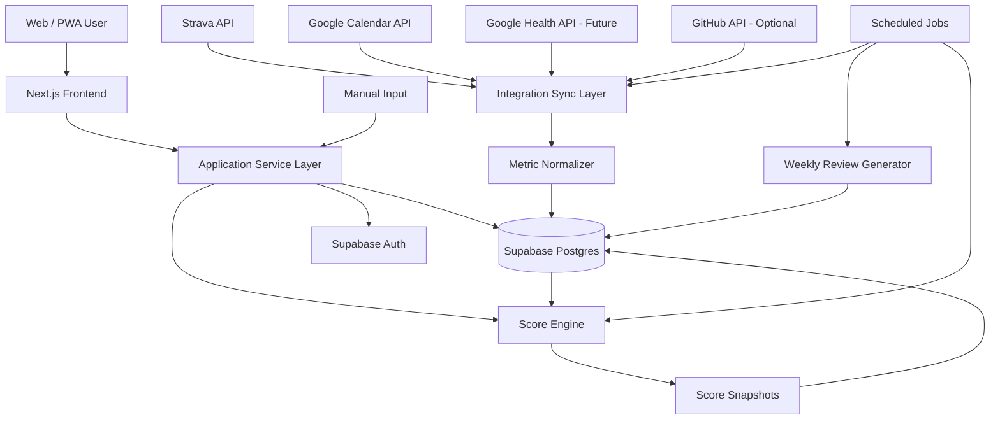
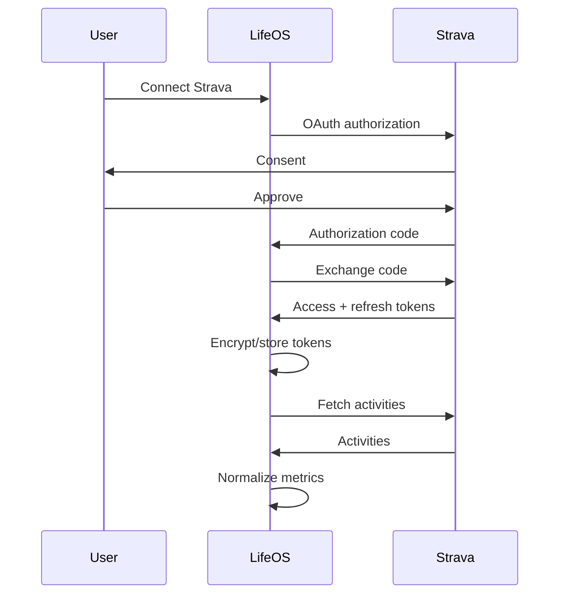

# Life OS — Product & Technical Specification

**Version:** 1.0  
**Date:** 2026-10-06  
**Primary platform:** Web / PWA  
**Future platform:** Native mobile if the product proves valuable  
**Initial user:** Sebastián  
**Status:** Ready for MVP implementation

---

## 1. Executive summary

**Life OS** is a personal analytics system that turns important areas of a person's life into measurable, reviewable metrics.

The system has two primary scores:

1. **Life Score** — measures the user's current state.
2. **Week Score** — measures whether the user executed the actions that should move that state forward.

The product is intentionally different from a normal habit tracker.

A habit tracker asks:

> Did I do the habit?

Life OS asks:

> Is my life objectively improving, what is limiting me, and am I executing the actions most likely to change it?

The application combines:

- Manual inputs.
- Health and fitness data.
- Running data.
- Calendar activity.
- Career progress.
- Business metrics.
- Financial metrics.
- Discipline / execution metrics.
- Weekly reviews.
- Historical score snapshots.
- Optional AI-generated analysis.

The MVP should be a responsive web application that can also be installed as a **PWA** on iPhone and desktop. A native mobile application should only be considered after the web MVP proves useful.

---

# 2. Product vision

## 2.1 Core idea

Life OS should function like a personal performance dashboard.

At any moment the user should be able to answer:

- Where am I?
- Am I improving?
- What is currently holding me back?
- Did I execute this week?
- Which area of my life is strongest?
- Which area is weakest?
- What should I attack next?
- Am I working hard on the wrong thing?
- How different am I from myself 30, 90, 180 or 365 days ago?

The system should minimize vague self-assessment.

Instead of:

> I feel like I am doing better.

Life OS should be able to show:

> Career +4.2 points in 30 days.  
> Body +2.8.  
> Business +0.3 despite 88% execution.  
> Business strategy may be the bottleneck.

---

# 3. Product principles

## 3.1 Results and execution must be separate

This is the most important design principle.

### Life Score

Measures **state**.

Examples:

- Current salary.
- Current role.
- Current 5K time.
- Current weight/body composition.
- Current savings.
- Current MRR.
- Current portfolio strength.
- Current client count.

### Week Score

Measures **execution**.

Examples:

- Planned workouts completed.
- QA study blocks completed.
- Applications sent.
- Outreach performed.
- Budget respected.
- Sleep target met.
- Weekly review completed.

This prevents a major failure mode:

A user can work extremely hard for a week without immediately changing their life.

Example:

```text
Life Score: 54 → 54.8
Week Score: 92
```

This means:

> Current state is still far from the goal, but execution is strong.

Conversely:

```text
Life Score: 54
Week Score: 31
```

This means:

> The primary problem is probably execution.

And:

```text
Life Score: 54 → 54.2 over 8 weeks
Average Week Score: 91
```

This suggests:

> Execution is high but results are stagnant. Strategy, targets or scoring assumptions should be investigated.

---

## 3.2 The score must not reward suffering

Life OS should reward **correct execution**, not pain.

Examples:

- A scheduled rest day counts as successful execution.
- Turning an easy run into an unnecessarily hard run should not earn bonus points.
- Working until 3 AM should not be rewarded simply because many hours were worked.
- Sending 100 low-quality applications should not necessarily score better than sending 10 high-quality ones.

The score should push the user toward outcomes, not burnout.

---

## 3.3 The system must be explainable

Every score should answer:

> Why is this number what it is?

If Career is 57.4, the user should be able to inspect:

```text
Career 57.4

Technical skills      61
Portfolio              48
Interview readiness    58
Market traction        42
Employment quality     70
```

And then inspect the underlying metrics.

No opaque score should exist.

---

## 3.4 Scores are configurable

The application should ship with defaults, but weights and targets must be editable.

Life priorities change.

A user may temporarily choose:

```text
Career    35%
Business  20%
Body      20%
Money     10%
Life      10%
Discipline 5%
```

Later those priorities can change.

Historical score snapshots must keep the scoring version that produced them.

---

# 4. Initial Life Score model

Recommended initial categories:

| Category | Weight |
|---|---:|
| Career | 25% |
| Business | 20% |
| Body | 20% |
| Money | 15% |
| Discipline | 10% |
| Life | 10% |
| **Total** | **100%** |

These values must be configurable.

---

# 5. Rank system

Recommended visual ranks:

| Score | Rank |
|---:|---|
| 0–29 | D |
| 30–44 | C |
| 45–59 | B |
| 60–74 | A |
| 75–89 | S |
| 90–99 | World Class |
| 100 | Complete |

`100` should not mean that life is objectively perfect.

It means:

> The currently defined target for this category has been conquered.

When the target changes, a new scoring version is created.

Example:

### Career v1 target

> Obtain first solid QA role.

Once achieved:

### Career v2 target

> Become a QA Automation Engineer earning $3,000+ / month.

The old score history remains valid under v1.

---

# 6. MVP scope

## 6.1 Must-have

The MVP should support:

- Authentication.
- Responsive dashboard.
- Life Score.
- Week Score.
- Six score categories.
- Custom category weights.
- Metric definitions.
- Manual metric entries.
- Goals and targets.
- Weekly commitments.
- Score history.
- Weekly review.
- Metric history charts.
- Data source indicator.
- Basic Strava integration.
- Google Calendar integration.
- PWA installation.
- Export of personal data.
- Integration architecture that allows Google Health later.

## 6.2 Strongly recommended for MVP

- Score breakdown.
- Current bottleneck.
- Strongest/weakest category.
- Trend over 7 / 30 / 90 days.
- Comparison against previous self.
- Notes attached to days/weeks.
- Health of integrations.
- Manual override of bad imported data.
- Dark mode.
- Mobile-first responsive design.

## 6.3 Not required for first MVP

Do **not** delay MVP for:

- Native iOS app.
- Native Android app.
- Bank API.
- Complex social features.
- Public profiles.
- Leaderboards.
- Full AI coach.
- Automatic job-board scraping.
- Fully automated agency CRM.
- Google Health integration before API access is available.
- Gamified animations.
- Wearable background sync from an iOS native app.

---

# 7. User journeys

## 7.1 First-run onboarding

1. User creates account.
2. User selects life categories.
3. User accepts default weights or customizes them.
4. User chooses initial objectives.
5. User defines target values.
6. User selects integrations.
7. User enters initial baseline metrics.
8. System calculates first Life Score.
9. User defines current week's commitments.
10. Dashboard becomes active.

---

## 7.2 Daily use

The user should usually spend less than 1–2 minutes manually entering data.

A normal day:

1. Automatic integrations sync.
2. User opens dashboard.
3. Imported metrics are displayed.
4. User manually enters anything missing.
5. User marks commitments if needed.
6. Scores update.
7. User can inspect trends.

---

## 7.3 Weekly review

Every week the system should create a review containing:

```text
Life Score
54.8 → 56.1 (+1.3)

Week Score
88

Career
+2.4

Business
+0.1

Body
+1.2

Money
-0.4

Discipline
+3.0

Life
-0.8
```

The review should answer:

- Biggest gain.
- Biggest decline.
- Weakest category.
- Strongest category.
- Execution rate.
- Metrics off target.
- Metrics improving fastest.
- Metrics stagnant despite high execution.
- Main bottleneck.
- Suggested next focus.

The user then creates the commitments for the next week.

---

# 8. Functional requirements

## FR-001 Authentication

The system shall allow a user to:

- Sign up.
- Sign in.
- Sign out.
- Recover access.
- Optionally use Google sign-in.

Recommended implementation:

**Supabase Auth**.

---

## FR-002 Profile

Store:

- Display name.
- Timezone.
- Preferred units.
- Week start day.
- Primary currency.
- Date of birth optional.
- Score configuration.
- Current primary objective.

Timezone must be stored because daily aggregation depends on local dates.

---

## FR-003 Categories

Users shall be able to:

- Create categories.
- Rename categories.
- Set weights.
- Enable/disable categories.
- Reorder categories.

Weights of active categories must total 100%.

---

## FR-004 Metric definitions

Every metric should have metadata.

Example:

```json
{
  "key": "weekly_running_km",
  "name": "Weekly running distance",
  "category": "body",
  "unit": "km",
  "period": "weekly",
  "direction": "higher_is_better",
  "source": "strava",
  "target": 15,
  "weight": 0.15
}
```

Supported direction modes:

- `higher_is_better`
- `lower_is_better`
- `target_range`
- `boolean`
- `milestone`
- `ratio`
- `custom`

---

## FR-005 Metric values

Metric values may originate from:

- Manual entry.
- Strava.
- Google Calendar.
- GitHub.
- Google Health.
- Imported CSV.
- Internal trackers.
- Computed metrics.

Every imported value must retain provenance.

Required metadata:

```text
metric_id
user_id
value
unit
occurred_at
source
source_record_id
confidence
created_at
updated_at
```

---

## FR-006 Goals

A goal represents a desired future state.

Examples:

- Run 5K under 25 minutes.
- Reach a specific job position.
- Obtain first agency client.
- Reach $2,000 MRR.
- Build a QA portfolio.
- Maintain a weekly running target.
- Save a target amount.

Goals may contain milestones.

---

## FR-007 Weekly commitments

Examples:

```text
3 runs
4 gym sessions
5 QA study sessions
5 quality job applications
30 agency prospects
1 weekly review
```

Each commitment should contain:

- Name.
- Category.
- Target quantity.
- Completion quantity.
- Scoring weight.
- Start date.
- End date.
- Status.

---

## FR-008 Life Score

System shall calculate:

```text
Life Score = Σ(category_score × category_weight)
```

Each category score:

```text
Category Score = Σ(metric_score × metric_weight)
```

All weights are normalized.

Scores are capped at:

```text
0 ≤ score ≤ 100
```

---

# 9. Scoring engine

## 9.1 Normalization

Different metrics need different scoring functions.

### Higher is better

Simple first version:

```text
score = clamp((current / target) × 100, 0, 100)
```

Example:

```text
Target savings: $5,000
Current savings: $2,500

score = 50
```

---

## 9.2 Lower is better

For metrics such as response time:

```text
score = clamp((target / current) × 100, 0, 100)
```

A more robust piecewise function should later replace this to avoid extreme behavior near zero.

---

## 9.3 Target range

Example sleep:

```text
target_min = 7 hours
target_max = 9 hours
```

Values inside the range score 100.

Values outside lose points based on distance from the accepted range.

---

## 9.4 Milestone scoring

Some goals are not continuous.

Example career progression:

```text
0   No relevant path
20  Learning fundamentals
40  Structured training
55  Demonstrable project
65  Strong portfolio
75  Interviews
90  Offer
100 Desired job obtained
```

Milestone scores must be explicitly defined.

---

## 9.5 Avoiding score manipulation

Rules:

- Cap excessive volume.
- Favor quality where measurable.
- Avoid rewarding duplicate events.
- Do not allow automatic data to be counted twice.
- Store source IDs for deduplication.
- Do not let one metric dominate an entire category accidentally.
- Display data completeness/confidence.

---

# 10. Week Score

Week Score should focus on controllable behaviors.

Suggested model:

```text
Week Score =
    commitments_completed_score
  + consistency_score
  + key_process_metrics
```

For MVP:

```text
Week Score = Σ(commitment_completion × commitment_weight)
```

Where:

```text
commitment_completion =
  min(actual / target, 1)
```

Example:

```text
Target: 3 runs
Actual: 3
Score: 100%

Target: 3 runs
Actual: 2
Score: 66.7%

Target: 3 runs
Actual: 5
Score: 100%
```

Doing more does not necessarily grant extra score.

This intentionally avoids encouraging unnecessary volume.

---

# 11. Strategy diagnostics

One of the highest-value features should be detecting relationships between execution and results.

Use a rolling window.

Example logic:

```text
IF average_week_score > 80
AND category_state_change < threshold
AND observation_window >= 4 weeks

THEN
  flag = "High execution, low outcome change"
```

Message:

> Execution is strong but this category is not improving. Investigate strategy, target selection or measurement.

Other diagnostic:

```text
IF average_week_score < 50
AND category_state_change <= 0

THEN
  flag = "Execution bottleneck"
```

This is not medical or psychological diagnosis.

It is product analytics.

---

# 12. Suggested initial category models

These are starting models, not hard-coded truth.

## 12.1 Career

Possible state metrics:

- Current employment quality.
- Compensation progress.
- QA technical competency.
- Automation competency.
- Portfolio quality.
- Interview readiness.
- Interview pipeline.
- Offer quality.

Possible execution metrics:

- Study sessions.
- Project work.
- Quality applications.
- Interview practice.
- CV improvements.

---

## 12.2 Business

State metrics:

- Clients.
- MRR.
- Qualified opportunities.
- Sales conversion.
- Positive reply rate.
- Retention.
- Validated offer maturity.

Execution metrics:

- Prospects researched.
- Outreach sent.
- Follow-ups.
- Discovery calls.
- Experiments run.
- Proposal work.

Recommended funnel:

```text
Prospects
   ↓
Contacted
   ↓
Replies
   ↓
Positive replies
   ↓
Discovery calls
   ↓
Proposals
   ↓
Clients
   ↓
MRR
```

---

## 12.3 Body

Potential state metrics:

- Running performance.
- Weekly volume.
- Strength performance.
- Weight/body composition if desired.
- Resting HR.
- Sleep.
- Recovery indicators.

Execution metrics:

- Runs completed.
- Gym sessions completed.
- Nutrition adherence.
- Sleep schedule adherence.
- Recovery days respected.

Health metrics should be treated as wellness information, not medical diagnosis.

---

## 12.4 Money

Possible state metrics:

- Emergency fund.
- Savings rate.
- Invested assets.
- Net worth.
- Debt.
- Income.

Execution:

- Planned contribution made.
- Budget respected.
- Spending reviewed.

MVP can use manual values.

Automated banking integrations should be considered later.

---

## 12.5 Discipline

Discipline should not simply duplicate the Week Score.

Possible measures:

- Commitment completion rate.
- Planned vs completed work blocks.
- Percentage of weeks with weekly review.
- Consistency streak measured carefully.

Avoid excessive streak mechanics.

Missing one day should not psychologically reset months of progress.

---

## 12.6 Life

This category intentionally balances performance metrics.

Possible metrics:

- Sleep.
- Planned leisure.
- Social time.
- Relationship time.
- Personal satisfaction check-in.
- Days with meaningful free time.

Some values will necessarily be subjective.

A 1–10 manual check-in is acceptable where objective measurement does not exist.

---

# 13. Technical architecture

## 13.1 Recommended stack

### Frontend

- Next.js
- TypeScript
- App Router
- React
- Tailwind CSS
- shadcn/ui
- Recharts

### Backend

- Next.js server routes / server actions for application logic.
- Supabase Postgres.
- Supabase Auth.
- Supabase Row Level Security.
- Background jobs using Vercel Cron or Supabase scheduled jobs.

### Deployment

- Vercel for application.
- Supabase managed Postgres.

### Mobile

MVP:

- Responsive web app.
- PWA manifest.
- Home Screen installation.

Future:

- React Native / Expo or native Swift/Kotlin only when required.

---

# 14. High-level architecture



---

# 15. Integration abstraction

Do not let external API payloads leak into the core score engine.

Create an adapter interface.

Conceptually:

```ts
interface IntegrationAdapter {
  connect(): Promise<void>;
  refreshToken(): Promise<void>;
  sync(from: Date, to: Date): Promise<NormalizedMetric[]>;
  disconnect(): Promise<void>;
  healthCheck(): Promise<IntegrationStatus>;
}
```

Then:

```text
StravaAdapter
GoogleCalendarAdapter
GoogleHealthAdapter
GitHubAdapter
CsvImportAdapter
```

All adapters output normalized metrics.

This design makes vendor changes survivable.

---

# 16. Google Health / Fitbit integration

## 16.1 Current status — important

As of **October 6, 2026**:

- Support for the legacy Fitbit Web API ended September 30, 2026.
- Google states that the legacy API will be turned off October 30, 2026.
- Google Health API is the successor.
- Google Health API uses Google OAuth.
- Google currently states that it is **not onboarding new projects** yet.
- Google recommends subscriptions/webhooks rather than aggressive polling once access is available.

Therefore:

### Do not build a new dependency on Fitbit Web API.

Create:

```text
GoogleHealthAdapter
```

but keep it disabled until project access is available.

The rest of Life OS must work without it.

Potential future health data:

- Steps.
- Activity.
- Exercise.
- Sleep.
- Heart rate.
- Other supported Google Health data types.

Official documentation:

- Google Health API — Get started
- Google Health API — Developer checklist
- Google Health API — REST reference
- Google Health API — Scopes

---

# 17. Strava integration

Strava should be one of the first automatic integrations.

Strava's API uses OAuth 2.0.

Useful data:

- Activities.
- Running distance.
- Duration.
- Pace/speed.
- Elevation.
- Activity type.
- Historical activity trends.

Flow:



Store Strava activity ID as the external record ID to prevent duplicates.

Respect Strava rate limits.

---

# 18. Google Calendar integration

Recommended initial permissions:

**Read-only unless a later feature clearly requires write access.**

Potential metrics:

- Planned QA study blocks.
- Gym sessions.
- Agency work.
- Planned free time.
- Scheduled commitments.

Calendar should not automatically assume:

> Event existed = event completed.

Possible strategies:

1. Calendar event = planned.
2. User confirms completion.
3. Or completed status comes from another data source.

This allows:

```text
planned_minutes
actual_minutes
completion_rate
```

Use least-privilege OAuth scopes.

---

# 19. GitHub integration

Optional MVP+ integration.

Potential metrics:

- Commits.
- Pull requests.
- Active development days.
- Project activity.

Do not use commit count as a direct measure of programming skill.

Good use:

> Did technical project work occur?

Bad use:

> More commits = better engineer.

GitHub's REST API provides commit endpoints and versioned APIs.

---

# 20. Manual data entry

Manual data is not a fallback to be ashamed of.

For many life metrics it is the correct data source.

Manual forms should be extremely fast.

Examples:

```text
Weight            [ 91.0 kg ]
Satisfaction      [ 7 / 10 ]
Savings balance   [ $____ ]
Applications      [ 3 ]
Agency replies    [ 1 ]
Study minutes     [ 45 ]
```

Support:

- Quick add.
- Edit.
- Delete.
- Backdated entries.
- Notes.

---

# 21. Data model

Recommended main tables.

## 21.1 profiles

```text
id UUID PK
user_id UUID FK auth.users
display_name TEXT
timezone TEXT
currency TEXT
week_starts_on SMALLINT
created_at TIMESTAMPTZ
updated_at TIMESTAMPTZ
```

---

## 21.2 score_categories

```text
id UUID PK
user_id UUID
key TEXT
name TEXT
weight NUMERIC
position INTEGER
enabled BOOLEAN
created_at
updated_at
```

Examples:

```text
career
business
body
money
discipline
life
```

---

## 21.3 metric_definitions

```text
id UUID PK
user_id UUID
category_id UUID FK
key TEXT
name TEXT
description TEXT
unit TEXT
period TEXT
direction TEXT
weight NUMERIC
aggregation TEXT
source_preference TEXT
config JSONB
enabled BOOLEAN
created_at
updated_at
```

`config` can contain:

```json
{
  "target": 15,
  "minimum": 0,
  "maximum": 20,
  "targetMin": 7,
  "targetMax": 9
}
```

---

## 21.4 metric_events

Canonical raw/normalized event store.

```text
id UUID PK
user_id UUID
metric_definition_id UUID
occurred_at TIMESTAMPTZ
value_numeric NUMERIC
value_text TEXT
value_json JSONB
unit TEXT
source TEXT
external_record_id TEXT
confidence NUMERIC
metadata JSONB
created_at
updated_at
```

Unique constraint recommended:

```text
(user_id, source, external_record_id, metric_definition_id)
```

where applicable.

---

## 21.5 metric_daily_rollups

Optional performance optimization.

```text
id
user_id
metric_definition_id
local_date DATE
value
aggregation_method
calculated_at
```

---

## 21.6 goals

```text
id
user_id
category_id
title
description
status
target_date
priority
created_at
completed_at
```

---

## 21.7 goal_milestones

```text
id
goal_id
name
target_value
score_value
position
completed_at
```

---

## 21.8 weekly_commitments

```text
id
user_id
category_id
week_start DATE
title
target_value
actual_value
unit
weight
completion_type
status
created_at
updated_at
```

---

## 21.9 score_versions

Very important.

```text
id
user_id
name
effective_from
effective_to
configuration JSONB
created_at
```

This preserves historical meaning when weights or scoring rules change.

---

## 21.10 score_snapshots

```text
id
user_id
score_version_id
snapshot_date
life_score
week_score
category_scores JSONB
metric_scores JSONB
created_at
```

Never recalculate old history silently using new scoring rules.

---

## 21.11 integrations

```text
id
user_id
provider
status
scopes JSONB
provider_user_id
last_synced_at
last_success_at
last_error
created_at
updated_at
```

---

## 21.12 oauth_credentials

Keep separate from ordinary integration metadata.

```text
id
integration_id
encrypted_access_token
encrypted_refresh_token
expires_at
token_type
created_at
updated_at
```

Never return these tokens to the browser.

---

## 21.13 sync_runs

```text
id
integration_id
started_at
finished_at
status
records_received
records_created
records_updated
error_code
error_message
metadata
```

---

## 21.14 weekly_reviews

```text
id
user_id
week_start
week_end
life_score_start
life_score_end
week_score
summary JSONB
user_notes TEXT
created_at
```

---

# 22. Database security

This application can contain sensitive health, financial and personal information.

Security must not be postponed.

Requirements:

- Enable PostgreSQL Row Level Security on exposed user tables.
- Every row must be scoped to its owner.
- Never expose service-role credentials to frontend code.
- OAuth tokens only accessible server-side.
- Encrypt provider tokens at rest at the application level if possible.
- Use HTTPS only.
- Request minimum OAuth scopes.
- Provide disconnect integration action.
- Provide delete account/data action.
- Provide export personal data.
- Avoid writing sensitive payloads to logs.
- Keep development and production secrets separate.
- Use separate Google Cloud projects for non-production and production Google Health environments when that integration becomes available.

Supabase recommends RLS for granular authorization and integrates it with Supabase Auth.

---

# 23. Suggested RLS pattern

Conceptually:

```sql
alter table metric_events enable row level security;

create policy "Users can read own metric events"
on metric_events
for select
using (auth.uid() = user_id);

create policy "Users can insert own metric events"
on metric_events
for insert
with check (auth.uid() = user_id);

create policy "Users can update own metric events"
on metric_events
for update
using (auth.uid() = user_id);
```

Equivalent policies should exist for every user-owned table.

Actual migrations should be reviewed and tested.

---

# 24. Backend modules

Recommended domain structure:

```text
src/
  app/
  components/
  features/
    dashboard/
    scores/
    metrics/
    goals/
    commitments/
    reviews/
    integrations/
  lib/
    auth/
    db/
    scoring/
    metrics/
    integrations/
      strava/
      google-calendar/
      google-health/
      github/
    analytics/
    security/
  jobs/
    sync-integrations/
    calculate-scores/
    generate-weekly-review/
```

---

# 25. API / server interface

Possible routes:

```text
GET    /api/dashboard
GET    /api/scores/current
GET    /api/scores/history
POST   /api/scores/recalculate

GET    /api/metrics
POST   /api/metrics/events
PATCH  /api/metrics/events/:id
DELETE /api/metrics/events/:id

GET    /api/goals
POST   /api/goals
PATCH  /api/goals/:id

GET    /api/commitments/current
POST   /api/commitments
PATCH  /api/commitments/:id

GET    /api/reviews
POST   /api/reviews/generate

GET    /api/integrations
POST   /api/integrations/strava/connect
POST   /api/integrations/google-calendar/connect
POST   /api/integrations/:provider/sync
DELETE /api/integrations/:provider
```

Next.js Server Actions can replace some explicit REST endpoints internally.

The important point is preserving clear service boundaries.

---

# 26. Dashboard requirements

The first screen should answer everything important within seconds.

Recommended hierarchy:

```text
┌──────────────────────────────────┐
│ LIFE SCORE               56.1 B  │
│ +1.3 this week                   │
├──────────────────────────────────┤
│ WEEK SCORE                  88   │
├──────────────────────────────────┤
│ Career       61 ↑                │
│ Business     24 →                │
│ Body         53 ↑                │
│ Money        51 ↓                │
│ Discipline   72 ↑                │
│ Life         62 →                │
├──────────────────────────────────┤
│ Main Objective                   │
│ Get next QA role                 │
├──────────────────────────────────┤
│ Weakest Stat                     │
│ Business                         │
├──────────────────────────────────┤
│ Current Bottleneck               │
│ Positive reply conversion        │
├──────────────────────────────────┤
│ This Week                        │
│ 7 / 9 commitments completed      │
└──────────────────────────────────┘
```

---

# 27. Main pages

## `/dashboard`

- Life Score.
- Week Score.
- Category scores.
- Trend.
- Objective.
- Weakest/strongest category.
- Current commitments.
- Integration sync state.

## `/score`

- Full breakdown.
- Weights.
- Metric contribution.
- Score explanation.

## `/metrics`

- All metrics.
- History.
- Data source.
- Manual entry.

## `/goals`

- Active goals.
- Milestones.
- Completed goals.

## `/week`

- Weekly commitments.
- Progress.
- Week Score.

## `/review`

- Weekly review.
- Comparison with previous weeks.
- Notes.
- Next-week planning.

## `/history`

- Life Score chart.
- Category trends.
- Compare dates.

## `/integrations`

- Strava.
- Google Calendar.
- Google Health placeholder/status.
- GitHub.
- CSV import.

## `/settings`

- Category weights.
- Scoring targets.
- Units.
- Privacy.
- Export/delete data.

---

# 28. History and "You vs You"

One of the signature features should be historical comparison.

User chooses:

```text
Today
vs
90 days ago
```

Example:

```text
                    90 days ago   Today
Life Score               49.2      61.4
Career                    43        67
Business                  12        36
Body                      48        59
Money                     54        58
Discipline                61        73
Life                      63        65
```

Also show raw metric changes.

This feature makes long-term growth tangible.

---

# 29. PWA strategy

The MVP should behave well enough on mobile that native development is unnecessary initially.

Requirements:

- Responsive layout.
- Web app manifest.
- Installable icon.
- Standalone display mode.
- Fast loading.
- Touch-friendly inputs.
- Offline shell optional.
- Cached dashboard optional.
- Safe handling when network returns.

Native mobile becomes justified if the product later needs:

- Apple Health / HealthKit direct access.
- Background health synchronization.
- Rich notifications.
- Widgets.
- Native shortcuts.
- Better offline support.
- Native wearable integration.

---

# 30. AI coach — post-MVP

AI should be an analysis layer, not the source of truth.

The AI receives structured values such as:

```json
{
  "lifeScore": 56.1,
  "weekScore": 88,
  "categoryChanges": {
    "career": 2.4,
    "business": 0.1,
    "body": 1.2
  },
  "commitmentCompletion": 0.88,
  "alerts": [
    "high_execution_low_business_result"
  ]
}
```

AI can then generate:

- Weekly summary.
- Bottleneck explanation.
- Suggested focus.
- Questions for reflection.

AI must **not** invent measurements.

All factual statements must originate from stored data.

---

# 31. Background jobs

Recommended jobs:

## Every few hours

```text
sync_strava
sync_calendar
```

Do not sync more frequently than needed.

## Daily

```text
aggregate_daily_metrics
calculate_life_score
save_score_snapshot
integration_health_check
```

## Weekly

```text
calculate_week_score
generate_weekly_review
prepare_next_week
```

Google Health should eventually prefer its supported subscription/webhook approach where appropriate rather than wasteful polling.

---

# 32. Observability

Track:

- Integration failures.
- OAuth refresh failures.
- Score calculation failures.
- Job duration.
- Last successful sync.
- Duplicate records.
- Missing required metric definitions.

The integrations page should visibly show:

```text
Strava
Connected
Last synced: 8 min ago

Google Calendar
Connected
Last synced: 14 min ago

Google Health
Unavailable for new projects
```

Never silently fail.

---

# 33. Data freshness

Every metric should include freshness.

Example:

```text
Steps
10,421
Updated 23 min ago
Source: Google Health
```

A stale metric should not look equivalent to a fresh metric.

Suggested statuses:

```text
fresh
delayed
stale
missing
error
```

---

# 34. Missing data

Missing data must not automatically equal bad performance.

Incorrect:

```text
No Fitbit sync → sleep score = 0
```

Correct:

```text
No Fitbit sync → sleep metric = unavailable
```

Then either:

- Reweight available metrics temporarily, or
- Mark category score as incomplete.

Recommended MVP:

Display:

```text
Body Score: 61
Data completeness: 82%
```

This makes uncertainty visible.

---

# 35. Score confidence

Optional but valuable.

Each category can have:

```text
score
confidence
```

Example:

```text
Body
Score: 67
Confidence: 95%

Career
Score: 58
Confidence: 72%
```

Confidence may consider:

- Data freshness.
- Number of active metrics.
- Percentage of automatic/manual sources.
- Missing values.

Do not mix confidence into the actual score.

Display separately.

---

# 36. Privacy requirements

The application may contain sensitive information.

User must be able to:

- View connected providers.
- View granted scopes.
- Disconnect provider.
- Delete imported provider data.
- Export their data.
- Delete account.
- Understand what information is collected.
- Understand why it is collected.

Future public launch requires formal privacy policy and terms.

Health integrations may impose additional developer policies and OAuth verification requirements.

---

# 37. Testing strategy

## Unit tests

Required for:

- Metric normalization.
- Score formulas.
- Weight normalization.
- Timezone/day boundaries.
- Missing-data handling.
- Deduplication.
- Rank calculation.

Example:

```text
Given:
target = 15 km
actual = 12 km

Expected:
score = 80
```

---

## Integration tests

Test:

- Supabase permissions.
- OAuth callbacks.
- Strava import.
- Calendar import.
- Token refresh.
- Duplicate synchronization.
- Failed provider response.

---

## End-to-end tests

Critical flows:

1. Sign up.
2. Complete onboarding.
3. Add manual metric.
4. See score change.
5. Add weekly commitment.
6. Complete commitment.
7. See Week Score update.
8. Connect Strava.
9. Import activity.
10. Disconnect Strava.
11. Generate weekly review.

Recommended:

**Playwright**.

---

# 38. Accessibility

At minimum:

- Keyboard navigation.
- Proper labels.
- Semantic HTML.
- Sufficient contrast.
- Do not communicate state only through color.
- Screen-reader friendly score labels.
- Reduced-motion respect.

Example:

Do not show only:

```text
Career: green
```

Show:

```text
Career: 72 — A — improving
```

---

# 39. Performance targets

MVP targets:

- Dashboard useful content visible quickly.
- Avoid unnecessary client-side fetch waterfalls.
- Precompute expensive score summaries.
- Cache appropriate read-only data.
- Lazy load historical charts.
- Paginate raw metric history.

No need for microservices.

A modular monolith is preferable.

---

# 40. MVP architecture decision

**Use a modular monolith.**

Do not begin with:

- Kafka.
- Multiple services.
- Kubernetes.
- Event-sourcing infrastructure.
- Complex queues unless actually required.

Initial architecture:

```text
Next.js
   │
   ├── UI
   ├── Server actions/API
   ├── Domain services
   ├── Integration adapters
   └── Score engine

Supabase
   ├── Postgres
   ├── Auth
   └── RLS

Vercel/Supabase Scheduler
   └── Background jobs
```

This is sufficient for an MVP and early product.

---

# 41. Development phases

## Phase 0 — Product definition

Deliverables:

- Confirm six categories.
- Define initial metric list.
- Define scoring rules.
- Define targets.
- Create wireframes.
- Set up repository.

---

## Phase 1 — Core

Build:

- Next.js app.
- Supabase.
- Auth.
- Profiles.
- Categories.
- Metric definitions.
- Manual metric entry.
- Score engine.
- Dashboard.

**Milestone:** Life Score works with manual data.

---

## Phase 2 — Weekly execution

Build:

- Weekly commitments.
- Week Score.
- Weekly review.
- Score snapshots.
- History.

**Milestone:** User can operate Life OS manually for an entire week.

---

## Phase 3 — First integrations

Build:

- Strava OAuth.
- Strava activity sync.
- Google Calendar OAuth.
- Calendar sync.
- Integration status.

**Milestone:** Important metrics begin updating automatically.

---

## Phase 4 — Better analytics

Build:

- You vs You.
- Bottleneck detection.
- Trends.
- Data completeness.
- Score confidence.
- Strategy alerts.

---

## Phase 5 — AI

Build:

- Structured weekly AI review.
- Objective-based suggestions.
- Explanation of stagnation.
- Next-week focus recommendation.

AI comes after trusted data.

---

## Phase 6 — Google Health

When Google allows the project:

- Configure Google Cloud project.
- Configure OAuth.
- Request minimal scopes.
- Implement GoogleHealthAdapter.
- Add supported health types.
- Add subscriptions/webhooks where appropriate.
- Test deduplication and timestamps.
- Enable integration.

---

## Phase 7 — Native mobile decision

Evaluate actual need.

Only build native app if data shows substantial benefit.

Potential choice:

- Expo / React Native.

Native iOS may become particularly useful if direct Apple HealthKit support becomes a product requirement.

---

# 42. MVP acceptance criteria

The MVP is successful when the user can:

- [ ] Create an account.
- [ ] Complete onboarding.
- [ ] See six life categories.
- [ ] Configure category weights.
- [ ] Define metrics.
- [ ] Enter manual measurements.
- [ ] Receive a Life Score.
- [ ] Inspect exactly why the score has that value.
- [ ] Create weekly commitments.
- [ ] Receive a Week Score.
- [ ] See weekly score history.
- [ ] See Life Score history.
- [ ] Complete a weekly review.
- [ ] Compare current self against a past date.
- [ ] Connect Strava.
- [ ] Import activities without duplicates.
- [ ] Connect Google Calendar.
- [ ] See integration status/errors.
- [ ] Install the application as a PWA.
- [ ] Export user data.
- [ ] Delete/disconnect integrations.
- [ ] Use the application comfortably on iPhone.

---

# 43. Definition of "done" for a metric

A metric is not complete simply because it displays a number.

Every metric should have:

- Name.
- Meaning.
- Unit.
- Category.
- Source.
- Current value.
- Historical values.
- Target.
- Scoring function.
- Weight.
- Freshness.
- Edit behavior.
- Missing-data behavior.
- Tests.

---

# 44. Recommended first metrics

To avoid overbuilding, start small.

## Career

- QA study minutes per week.
- QA project sessions.
- Quality applications.
- Interviews.
- Career milestone level.

## Business

- Prospects contacted.
- Replies.
- Positive replies.
- Discovery calls.
- Clients.
- MRR.

## Body

- Runs per week.
- Running distance.
- Gym sessions.
- Steps.
- Sleep duration.
- Weight optional.

## Money

- Liquid savings.
- Investments.
- Monthly contribution.
- Debt if applicable.

## Discipline

- Weekly commitment completion %.
- Weekly review completed.

## Life

- Sleep goal adherence.
- Free-time satisfaction 1–10.
- Weekly life satisfaction 1–10.

Start with approximately **20–25 metrics**, not 100.

---

# 45. Product risks

## Risk: Score obsession

A single number can become psychologically over-important.

Mitigation:

- Always show component breakdown.
- Avoid daily punishment language.
- Avoid negative streak resets.
- Allow subjective reflection.
- Treat score as navigation, not personal worth.

---

## Risk: False precision

A score such as `62.43` can imply more certainty than the model deserves.

Mitigation:

UI may display:

```text
62
```

while calculations retain decimals internally.

---

## Risk: Bad scoring model

The first scoring model will be imperfect.

Mitigation:

- Version it.
- Make weights configurable.
- Keep raw measurements.
- Never destroy original data.
- Iterate based on usefulness.

---

## Risk: API dependency

External APIs change.

Mitigation:

Integration adapter architecture.

This is especially important because Fitbit is currently transitioning to Google Health API.

---

## Risk: Too much manual input

Mitigation:

- Quick-add UI.
- Defaults.
- Automatic integrations.
- Weekly rather than daily values when possible.
- Only collect metrics that change decisions.

---

# 46. Repository documentation

Recommended root files:

```text
README.md
PRODUCT.md
ARCHITECTURE.md
SCORING.md
INTEGRATIONS.md
SECURITY.md
ROADMAP.md
AGENTS.md
.env.example
```

For a solo project, this master specification can initially serve as the source for those files.

---

# 47. Suggested environment variables

Example only:

```bash
NEXT_PUBLIC_APP_URL=

NEXT_PUBLIC_SUPABASE_URL=
NEXT_PUBLIC_SUPABASE_ANON_KEY=
SUPABASE_SERVICE_ROLE_KEY=

TOKEN_ENCRYPTION_KEY=

STRAVA_CLIENT_ID=
STRAVA_CLIENT_SECRET=
STRAVA_REDIRECT_URI=

GOOGLE_CLIENT_ID=
GOOGLE_CLIENT_SECRET=
GOOGLE_CALENDAR_REDIRECT_URI=

# Future
GOOGLE_HEALTH_ENABLED=false
GOOGLE_HEALTH_CLIENT_ID=
GOOGLE_HEALTH_CLIENT_SECRET=

# Optional AI
OPENAI_API_KEY=
```

Secrets must never be committed.

---

# 48. Suggested first repository milestones

```text
M1: Dashboard skeleton
M2: Supabase schema + auth
M3: Manual metric engine
M4: Life Score engine
M5: Weekly commitments + Week Score
M6: Score snapshots + history
M7: Strava OAuth + sync
M8: Calendar integration
M9: PWA
M10: Weekly review
M11: Strategy diagnostics
M12: AI coach
M13: Google Health when available
```

---

# 49. First implementation backlog

## Epic 1 — Project foundation

- [ ] Create Next.js TypeScript app.
- [ ] Configure Tailwind.
- [ ] Configure shadcn/ui.
- [ ] Create Supabase project.
- [ ] Configure Supabase Auth.
- [ ] Create environment validation.
- [ ] Add linting.
- [ ] Add formatting.
- [ ] Add test framework.
- [ ] Set up CI.

## Epic 2 — Database

- [ ] Profiles migration.
- [ ] Categories migration.
- [ ] Metric definitions migration.
- [ ] Metric events migration.
- [ ] Goals migration.
- [ ] Commitments migration.
- [ ] Score versions migration.
- [ ] Score snapshots migration.
- [ ] Integrations migration.
- [ ] RLS policies.
- [ ] Database tests.

## Epic 3 — Scoring

- [ ] Normalization functions.
- [ ] Metric scoring.
- [ ] Category scoring.
- [ ] Life Score.
- [ ] Rank calculation.
- [ ] Missing-data handling.
- [ ] Scoring tests.
- [ ] Score explanations.

## Epic 4 — UI

- [ ] Dashboard.
- [ ] Score detail.
- [ ] Manual metric input.
- [ ] Goals.
- [ ] Weekly commitments.
- [ ] Weekly review.
- [ ] History.
- [ ] Settings.

## Epic 5 — Integrations

- [ ] Generic adapter interface.
- [ ] Integration status UI.
- [ ] Strava OAuth.
- [ ] Strava sync.
- [ ] Calendar OAuth.
- [ ] Calendar sync.
- [ ] Sync logging.
- [ ] Retry handling.

## Epic 6 — PWA

- [ ] Manifest.
- [ ] Icons.
- [ ] Mobile navigation.
- [ ] Install testing.
- [ ] iPhone Safari testing.

---

# 50. Suggested build order for an AI coding agent

An agent such as Codex/Jarvis should **not** attempt the whole project in one prompt.

Recommended sequence:

### Task 1

> Initialize the Next.js TypeScript project, install the selected UI/testing dependencies, establish the folder structure, add environment validation and create a minimal authenticated shell. Do not implement business logic yet.

### Task 2

> Implement the Supabase database schema and RLS policies described in the Life OS specification. Add migrations and tests. Do not implement integrations yet.

### Task 3

> Implement the scoring domain as pure TypeScript functions with comprehensive unit tests. No UI dependencies.

### Task 4

> Build manual metric entry and show a fully explainable Life Score on the dashboard.

### Task 5

> Implement weekly commitments and Week Score.

### Task 6

> Implement score snapshots and historical charts.

### Task 7

> Implement the generic integration adapter system and then the Strava adapter.

### Task 8

> Implement Google Calendar.

### Task 9

> Add PWA support and perform full mobile verification.

This keeps each task testable and prevents an AI agent from creating a large unverified codebase.

---

# 51. Architectural rules for coding agents

Place this philosophy in `AGENTS.md`:

1. **Do not hard-code scoring weights into UI components.**
2. **Do not couple scoring logic to third-party API payloads.**
3. **All provider data passes through a normalization layer.**
4. **All user-owned tables require authorization/RLS.**
5. **Provider secrets never reach the browser.**
6. **Every scoring function requires unit tests.**
7. **Historical scores are immutable snapshots.**
8. **Scoring configuration changes create a new score version.**
9. **Missing data is not equivalent to zero performance.**
10. **Do not build an integration before its data changes a product decision.**
11. **Prefer a modular monolith over premature microservices.**
12. **The dashboard must always explain its numbers.**

---

# 52. Future opportunities

If Life OS becomes genuinely useful, possible expansions include:

- Apple Health / HealthKit.
- Native iOS app.
- Android Health Connect.
- Finance integrations.
- Job application tracker.
- Browser extension for applications.
- Agency CRM integration.
- Automatic skill map.
- Goal forecasting.
- Personalized AI coach.
- Morning brief.
- Weekly review notifications.
- Monthly retrospective.
- Life timeline.
- Achievement system.
- Personal API.
- Home-screen widgets.
- Calendar planning based on priorities.

---

# 53. What Life OS should NOT become

Avoid turning the product into:

- A punishment system.
- A productivity vanity dashboard.
- A giant collection of meaningless metrics.
- A replacement for medical advice.
- A system where every minute of life must be optimized.
- A leaderboard against strangers.
- A score of human worth.

The score represents:

> Progress relative to intentionally chosen goals.

Nothing more.

---

# 54. North-star product test

Before adding any metric or integration, ask:

> **Will this data change a decision?**

If the answer is no, do not add it.

Before adding any feature, ask:

> **Does this make it easier to understand where I am, whether I am executing, or what I should focus on next?**

If the answer is no, it probably does not belong in the MVP.

---

# 55. Recommended MVP definition

The smallest genuinely valuable Life OS is:

```text
Authentication
      +
Manual metrics
      +
Life Score
      +
Weekly commitments
      +
Week Score
      +
History
      +
Strava
      +
Calendar
      +
Weekly review
      +
PWA
```

That is enough to test the central hypothesis:

> **Does continuously measuring state + execution lead to better personal decisions and visible progress?**

Only after answering that question should the system grow.

---

# 56. Final architecture summary

```text
                       LIFE OS
                          │
             ┌────────────┴────────────┐
             │                         │
          STATE                     EXECUTION
       Life Score                   Week Score
             │                         │
      ┌──────┴──────┐          ┌──────┴──────┐
      │ Categories  │          │ Commitments │
      └──────┬──────┘          └──────┬──────┘
             │                         │
          Metrics                 Actions
             │                         │
             └──────────┬──────────────┘
                        │
                 Normalized data
                        │
        ┌───────────────┼──────────────────┐
        │               │                  │
     Manual          Strava            Calendar
        │                                  │
     Finance          GitHub          Google Health
                                    (when available)
                        │
                        ▼
                 Supabase/Postgres
                        │
                        ▼
                  Score Engine
                        │
                        ▼
                Historical snapshots
                        │
                        ▼
                  Weekly analysis
                        │
                        ▼
                 Next best focus
```

---

# 57. Current external-API notes

These details were verified when this specification was produced on **2026-10-06** and should be rechecked before implementation.

### Google Health

Google states that the legacy Fitbit Web API lost support on September 30, 2026 and will be turned off on October 30, 2026. The replacement is Google Health API. Google currently says it is not onboarding new projects, though access is expected to expand. Google Health uses OAuth and supports REST/RPC APIs, scopes and subscriptions/webhooks.

References:

- https://developers.google.com/health/get-started
- https://developers.google.com/health/developer-checklist
- https://developers.google.com/health/reference/rest
- https://developers.google.com/health/scopes

### Strava

Strava API uses OAuth 2.0, provides athlete/activity/route/gear data, and enforces application rate limits.

References:

- https://developers.strava.com/docs/authentication/
- https://developers.strava.com/docs/getting-started/

### Google Calendar

Google Calendar uses OAuth 2.0 scopes. Life OS should request the minimum required scope, ideally read-only for MVP.

Reference:

- https://developers.google.com/workspace/calendar/api/auth

### GitHub

GitHub exposes versioned REST endpoints for repository commits and related development activity.

Reference:

- https://docs.github.com/en/rest/commits

### Supabase

Supabase Auth uses JWTs and integrates with PostgreSQL Row Level Security. RLS should protect every exposed user-owned table.

References:

- https://supabase.com/docs/guides/auth
- https://supabase.com/docs/guides/database/postgres/row-level-security

---

# 58. Immediate next step

Do **not** begin with Fitbit/Google Health.

Begin with:

1. Repository.
2. Next.js web shell.
3. Supabase Auth/database.
4. Manual metrics.
5. Score engine.
6. Dashboard.
7. Week Score.
8. History.
9. Strava.
10. Calendar.

At that point Life OS is already useful.

Google Health becomes an additional data source rather than a dependency that can block the project.

---

## Project statement

> **Life OS is a personal performance system that measures current state, measures execution separately, preserves historical progress, integrates reliable external data, and identifies the highest-leverage area to improve next.**

The application should make one question answerable every week:

> **What is the weakest part of my game right now, and what am I going to do about it?**
